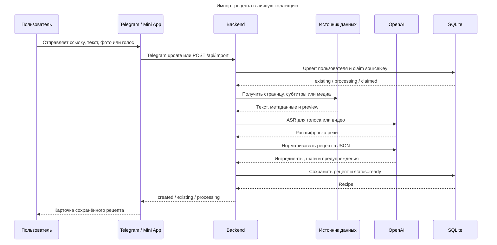
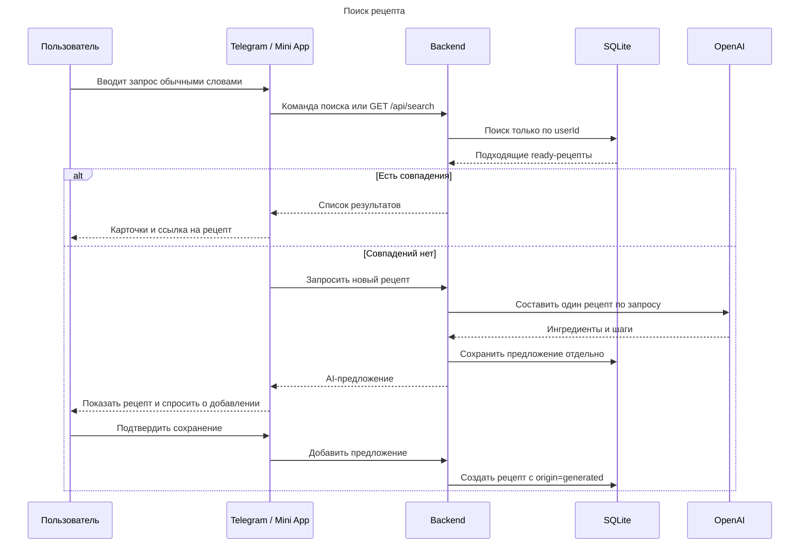

# Data sequence diagram

Актуально по локальной реализации на 23 сентября 2026 года.

## 1. Импорт рецепта

`sourceKey` обеспечивает дедупликацию: повторный источник возвращает существующий рецепт или текущую задачу и не создаёт лишний AI-вызов. Для обычного текста, изображения и страницы шаг ASR пропускается. Для текстового импорта шаг получения внешнего источника также пропускается.

## 2. Поиск в личной коллекции

Поиск локальный. При пустом результате отдельный AI-вызов составляет предложение, которое сохраняется в коллекции только после явного подтверждения. Все чтения и записи рецептов изолированы по Telegram-пользователю.
