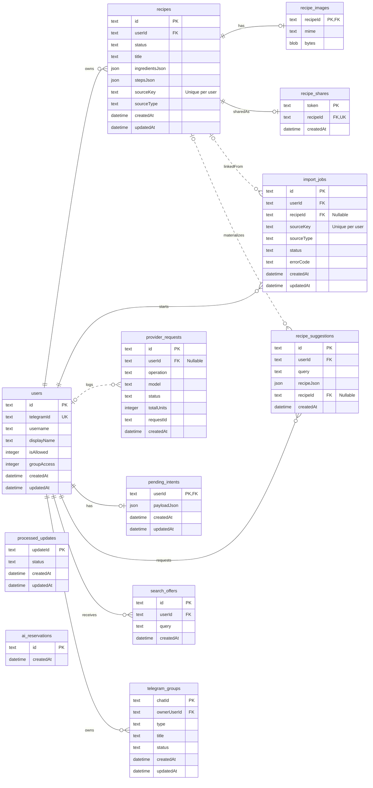

# Recipeboibot ERD

Схема соответствует SQLite-модели в `src/db.js` на 23 сентября 2026 года. Для читаемости показаны ключевые поля; полный DDL остаётся источником истины.

Таблицы `processed_updates` и `ai_reservations` не имеют внешних ключей. Они отвечают соответственно за идемпотентность Telegram updates и учёт попыток AI-вызовов. Историческое имя `ai_reservations` сохранено для совместимости с существующей БД.

Составные уникальные индексы:

- `recipes(user_id, source_key)` при непустом `source_key`;
- `import_jobs(user_id, source_key)` при непустом `source_key`.
